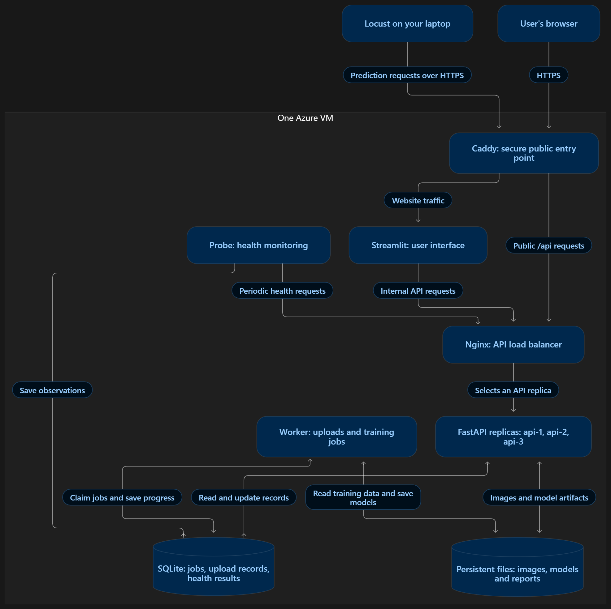
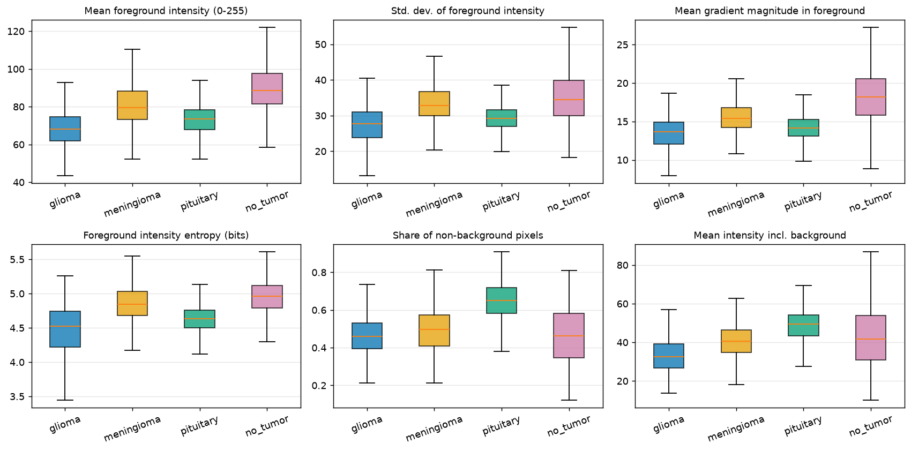

# Brain MRI Tumour Classifier  BRISC 2025 (educational ML-cycle project)

> **Educational prototype  not a diagnostic service.** The model sorts a single brain MRI
> slice into one of four classes it was trained on. Its confidence is a model score, not a
> clinical probability, and it can be confidently wrong  including on images that are not
> brain MRI slices.


**For the admin key for retraining you can check the readme which is in the zipped folder**

**My mission** is to improve access to practical healthcare education in Africa by developing
digital learning tools that help students explore medical imaging and understand the responsible
use of artificial intelligence.

**Learning problem addressed:** students need practical opportunities to understand how medical-image
predictions are produced, evaluated and sometimes wrong. This project provides an interactive
learning environment for examining MRI classification, confidence scores and model limitations.
It demonstrates an ML workflow; educational impact has not been measured in a learner study.

One four-class CNN, trained **from randomly initialised weights** (no transfer learning,
no externally pretrained parts, no hosted prediction services), predicts `glioma`, `meningioma`,
`pituitary` or `no_tumor`. The tumour status shown to users is derived from that output:

* `no_tumor` → **"No tumor detected in this image."**
* any other class → **"Tumor detected — predicted type: [class]."**

**New installation:** follow [docs/SETUP.md](docs/SETUP.md) to create your own environment
and admin key, prepare the data, run the app or train a new model from scratch.

Predictions load the active version's `models/versions/<version>/model.h5`. The health
endpoint reports `model_artifact: "model.h5"` once that model is loaded. See
[the HDF5 deployment update](deploy/azure/HDF5_UPDATE.md) for updating an existing Azure installation.

### Results at a glance (actual, from `reports/models/`)

| Model | Parameters | Validation macro-F1 | **Final test accuracy** | **Final test macro-F1** | Test tumour sensitivity / specificity |
|---|---|---|---|---|---|
| Baseline CNN (v001) | 4,932 | 0.678 | 0.632 | 0.630 | — |
| **Final CNN (v002, served)** | 295,188 | 0.930 | **0.888** | **0.895** | 0.986 / 0.977 |

Final test = 868 held-out images, evaluated once after model selection. Per-class test F1: glioma
0.928, meningioma 0.827, pituitary 0.865, no_tumor 0.961; macro ROC-AUC 0.992; expected calibration
error 0.031. **Known weaknesses:** pituitary slices are often called meningioma (55/259), and the model
partly relies on an acquisition shortcut — meningioma slices from non-512×512 sources are called
`no_tumor` 25.8 % of the time (vs 1.0 % at 512×512), causing 8 of the 10 missed tumours. Details:
notebook §8 and [Limitations](#limitations).

### Where to find everything

| What | Where |
|---|---|
| **Trained model (served)** | **`models/brain_mri_classifier.h5`** — copy of `models/versions/v002/model.h5` (same file, identical predictions) |
| Same model, native Keras format + metadata, training history, input-gate calibration | `models/versions/v002/` (`model.keras`, `metadata.json`, `history.json`, `input_gate.npz`) |
| Baseline and retrained candidate | `models/versions/v001/` (baseline), `models/versions/v003/` (retraining run, not promoted); `models/registry.json` records which is active |
| Notebook (executed, 0 errors) | `notebook/brain_mri_classifier.ipynb` |
| Preprocessing / model / prediction code | `src/preprocessing.py`, `src/model.py`, `src/prediction.py` (+ `src/input_gate.py`) |
| Retraining code | `src/retraining.py` (job), `worker/main.py` (background worker), `src/ingestion/` (upload checks + staging), `src/pipeline.py`, `src/training.py` |
| Training data | `data/train/<class>/` — 4,020 images |
| Test data | `data/test/<class>/` — 868 images (held out; evaluated once) |
| Split lists and cleaning records | `data/manifests/` (validation and retrain-demo images are regenerated with `scripts/prepare_dataset.py`) |
| Evaluation results and figures | `reports/models/v002/` (metrics, confusion matrices, training curves, predictions) |
| API · UI · Docker | `api/`, `ui/`, `docker-compose.yml`, `deploy/docker/` |
| Load-test results | `loadtest/results/` and `loadtest/README.md` |
| Tests | `tests/` — reproducible regression suite; see [Tests](#tests) |

**Video demo:** [Watch on YouTube](https://youtu.be/7QIUv2JxGkg).

**Repository:** [GitHub source](https://github.com/gilbmura/Mlops_structure) (publish the latest local changes).

**Deployed app:** [Open the Azure application](https://gilbert-brain-mri-demo.southafricanorth.cloudapp.azure.com).
Availability depends on the VM's running schedule.

**API:** [Interactive documentation](https://gilbert-brain-mri-demo.southafricanorth.cloudapp.azure.com/api/docs)
and [live health check](https://gilbert-brain-mri-demo.southafricanorth.cloudapp.azure.com/api/health).

**Demonstration evidence:** the project author confirms that the
[video](https://youtu.be/7QIUv2JxGkg) demonstrates production model evaluation and
the Azure performance comparison with 1, 2 and 3 API replicas. Downloadable
stress-test and routing evidence is also included under `loadtest/results/azure_final/`.

---

## Contents

1. [Architecture](#architecture) · 2. [Repository layout](#repository-layout) · 3. [Setup](#setup)
4. [Data preparation](#data-preparation) · 5. [Training and evaluation](#training-and-evaluation)
6. [Running locally](#running-locally-without-docker) · 7. [Docker](#docker-and-load-balancing)
8. [Uploads and retraining](#uploads-review-and-retraining) · 9. [Load testing](#load-testing)
10. [Tests](#tests) · 11. [Azure](#azure-deployment) · 12. [Dataset licence](#dataset-licence-and-attribution)
13. [Limitations](#limitations) · 14. [Submission](#submission-packaging) · 15. [Status of deliverables](#status-of-deliverables)

Dataset exploration: [three feature interpretations](#dataset-insights).

## Architecture



* **API** (`api/`) — prediction, uploads, review, job status, model status, rollback. Never trains.
* **Worker** (`worker/main.py`) — runs queued jobs one at a time, outside any web request.
* **Probe** (`worker/probe.py`) — measures availability through the load balancer.
* **UI** (`ui/`) — talks only to the API over HTTP; no TensorFlow in the UI image.
* **Core ML** (`src/`) — data preparation, preprocessing, model, training, evaluation, registry.

## Repository layout

```
README.md
notebook/brain_mri_classifier.ipynb   executed notebook (imports src/, no duplicated logic)
src/
  preprocessing.py   model.py   prediction.py          (assignment-required modules)
  labels.py          fixed class order + derived tumour message
  augmentation.py    tf.data pipelines; augmentation for training batches only
  training.py  pipeline.py  evaluation.py  promotion.py  registry.py  retraining.py
  input_gate.py      rule checks + feature-distance refusal of non-MRI-like inputs
  features.py  plots.py
  dataset/           source.py (read-only ZIP) · fingerprint.py · dedup.py · splitting.py · prepare.py · manifests.py
  ingestion/         archive.py (ZIP safety) · screening.py (duplicates/leakage) · service.py (staging) · limits.py
  storage/           database.py · jobs.py · uploads.py · probes.py   (SQLite)
utils/               hashing.py · images.py · files.py · log.py
config/              pipeline.yaml (behaviour) · settings.py (environment)
api/  ui/  worker/   FastAPI app · Streamlit app · background worker + availability probe
scripts/             prepare_dataset.py · train_model.py · evaluate_model.py · analyze_features.py · check_deployment.py · calibrate_input_gate.py
tests/               pytest suite
loadtest/            locustfile.py · run_scaling.py · README.md (conditions + interpretation) · results/ (raw CSVs + summary)
deploy/docker/       Dockerfile.api · Dockerfile.ui · nginx.conf      (docker-compose.yml at the root)
deploy/azure/        deployment guide, dry-run provisioning script, HTTPS override
data/  models/  reports/    see data/README.md and models/README.md
docs/SETUP.md        installation, environment, admin key and first-run instructions
```

## Setup

Verified on Windows 11, Python 3.13.2, Intel i5-1135G7 (4 cores / 8 threads), 15.6 GB RAM, **no CUDA GPU**
(training runs on CPU). TensorFlow 2.20.0 (`tensorflow-cpu`) supports Python 3.13 on Windows and Linux.

```powershell
python -m venv .venv
.\.venv\Scripts\Activate.ps1
python -m pip install -r requirements.txt
Copy-Item .env.example .env      # then set ADMIN_API_KEY (instructions inside)
python -c "import secrets; print(secrets.token_urlsafe(32))"
```

For a fresh checkout, put the generated value after `ADMIN_API_KEY=` in your private `.env`.
Use it in your own UI's admin field. Never commit that file or publish your key. When updating
an existing installation, preserve its `.env` rather than copying over it.

On Linux with an NVIDIA GPU, install `tensorflow[and-cuda]==2.20.0` instead of `tensorflow-cpu`;
the code uses any visible GPU automatically. Native-Windows TensorFlow has no GPU support.

## Data preparation

```powershell
python scripts/prepare_dataset.py --archive "C:\path\to\archive.zip"
```

The ZIP is opened read-only. The pipeline verifies the manifest checksum sidecars, that
`manifest.csv` and `manifest.json` agree, every row's path/label/filename-code/split, each
file's SHA-256, and that every image decodes. It then removes exact duplicates, links
near-duplicates and related slices, and builds a new group-aware split.
Outputs and their meaning: [data/README.md](data/README.md).

**Findings (reproduced from the ZIP, not assumed):**

| Check | Result |
|---|---|
| Classification files (glioma / meningioma / pituitary / no_tumor) | 6,000 (1,401 / 1,635 / 1,757 / 1,207); supplied split 5,000 / 1,000 |
| Manifest sidecar checksums, CSV = JSON, row consistency | all pass; 0 issues |
| Decode + SHA-256 vs manifest | 6,000 / 6,000 OK |
| Stored colour mode | 3,134 RGB (all with identical channels) + 2,866 greyscale; 183 distinct resolutions |
| Exact duplicates (identical decoded pixels) | 134 groups, **98 crossing the supplied train/test split**, 0 with conflicting labels → 144 copies removed |
| **Unique images kept** | **5,856** (≥ 5,000 target met) |
| Near-duplicate pairs (resized copies; Hamming ≤ 12, r ≥ 0.98) | 46 — kept, forced into the same split |
| Related pairs (likely neighbouring slices; Hamming ≤ 8, r ≥ 0.93) | 1,311 — kept, forced into the same split |
| Review-only pairs (Hamming ≤ 10, r ≥ 0.90) | 1,497 — flagged in `similar_pairs.csv`, not linked |
| Linked groups | 647 groups, 1,930 images, largest 9, none mixing classes |
| New split (train / validation / test / retrain-demo) | 4,020 / 868 / 868 / 100, stratified by class × plane; 0 groups or pixel hashes cross splits |
| Segmentation task | 9,586 files (4,793 images + 4,793 masks); every image is a byte copy of a classification image → not counted |
| Filename code for no-tumour | the README says `nt`, every file uses `no` (both accepted) |

Thresholds were chosen after visually reviewing pairs in each band (notebook §2): at the looser
review rule, groups start mixing classes, so it is used for flagging only. **Patient separation cannot
be guaranteed** — there are no patient identifiers. Re-running the script reproduces every manifest
byte for byte (verified).

## Dataset insights

These measurements use the 4,020 training images after standardization to 128×128.
Foreground measurements exclude pixels with intensity ≤ 20 so black padding does not
dominate the statistics. Full analysis appears in notebook section 4 and the
[feature summary](reports/dataset/feature_summary.json).



* **Brightness:** median foreground intensity is about 68.0 for glioma and 88.5 for
  no-tumour images. This dataset contains class-associated intensity differences that
  the model could exploit; brightness alone does not establish a tumour diagnosis.
* **Contrast:** median foreground standard deviation is about 27.7 for glioma and
  34.4 for no-tumour images. The intensity variation differs between these groups,
  but their distributions overlap, limiting this feature as a standalone classifier.
* **Texture:** median foreground gradient magnitude is about 13.6 for glioma and
  18.2 for no-tumour images. The latter group has stronger local intensity changes
  in this collection; this is an image-statistics observation, not a clinical rule.

Together, these features show that intensity and acquisition characteristics carry
class information. The notebook also finds differences in source resolution and
framing, so a CNN may learn collection-specific patterns alongside anatomy. These
findings explain why testing on independent sources matters.

## Training and evaluation

```powershell
python scripts/train_model.py --smoke                    # ~1 min end-to-end check (separate registry)
python scripts/train_model.py --architecture baseline    # simple baseline
python scripts/train_model.py --activate                 # final CNN → served model
python scripts/evaluate_model.py --split validation      # development checks
python scripts/evaluate_model.py --split test            # final test, once (won't overwrite without --force)
python scripts/analyze_features.py                       # brightness / contrast / texture by class (training split)
```

Preprocessing (shared by training, notebook and API): decode by content → greyscale →
letterbox to square (black padding) → 128×128 bilinear → [0, 1]. Augmentation (flip, ±10°
rotation, zoom, shift, contrast, brightness) applies to training batches only. Class
weights come from training labels only. Early stopping and model selection use validation
macro-F1. Every registered model stores its class order, preprocessing spec, training
config, seed, history, dataset version and a reload check of both `.keras` and `.h5`.

## Running locally (without Docker)

```powershell
uvicorn api.main:create_app --factory --port 8000     # API  → http://127.0.0.1:8000/docs
python -m worker.main                                  # worker (separate terminal)
python -m worker.probe --interval 30                   # optional availability probe
streamlit run ui/app.py                                # UI   → http://localhost:8501
```

Main endpoints: `POST /predict`, `GET /health`, `GET /availability`, `GET /model`, `GET /models`,
`GET /insights/dataset`, `GET /insights/evaluation`, `POST /uploads/images`, `POST /uploads/zip`,
`GET /uploads`, `PATCH /uploads/{id}`, `POST /uploads/admit`, `POST /jobs/retrain`,
`GET /jobs/{id}`, `GET /jobs/{id}/log`, `POST /models/{version}/activate`, `POST /models/rollback`.
Data-changing endpoints require the `X-Admin-Key` header (value of `ADMIN_API_KEY`); they are
disabled entirely if no key is configured.

**Uptime vs availability.** `/health` reports how long *that replica's process* has run.
Availability is measured separately by the probe, which calls `/health` through the load
balancer every 30 s and records successes; the UI shows both, labelled differently.

**Input validation.** Files are validated by content (JPEG/PNG only, size and dimension
limits, decompression-bomb guard, truncated-file detection); non-images get HTTP 422.

**Input gate — no diagnosis for images that do not look like training MRIs** (`src/input_gate.py`).
A four-class softmax always picks *some* class, so before classifying, every image must pass:

* **Rules** (thresholds from the BRISC data, `config/pipeline.yaml` → `input_gate`): not a colour image
  (every BRISC file is greyscale); aspect ratio ≤ 2.5 (widest BRISC slice 1.97); not near-uniform (flattest
  BRISC slice has std 19.9); dark border (MRI backgrounds are black; only 2 of 5,856 real slices exceed the limit).
* **Feature distance:** Mahalanobis distance of the CNN's own penultimate features to the nearest
  training-class mean (shared Ledoit–Wolf covariance; no pretrained parts). Threshold = 99th percentile of
  real **validation** MRIs, so ~1 % of genuine slices are refused by design. Each model version stores its own
  calibration (`input_gate.npz`); new models are calibrated automatically when registered, older ones with
  `python scripts/calibrate_input_gate.py`.

A refused image returns `accepted: false`, the message *"This doesn't look like a brain MRI slice, so no
prediction is shown."* and `rejection_reasons` — **no class, score or tumour message** (API, ZIP batch and UI
alike). Measured for the served model (`reports/input_gate/v002.json`; threshold fixed on validation):

| Input | Result |
|---|---|
| Real MRIs refused | validation 1.0 % (by design) · test 0.6 % (5/868) · retrain-demo 0 % |
| 8 non-MRI probes: colour and greyscale portrait photo, product photo, logo, terrain map, noise, dark noise, blank image | all 8 refused (6 by rules, 2 by feature distance) |
| Brain MRI from another source (matplotlib `s1045`), BRISC slice rotated 90° | both accepted |

Refusals of real slices concentrate in the under-represented non-512×512 sources (4 of 31 such test
meningioma slices vs 0 of 194 at 512×512). The gate makes confident answers on unrelated images much
rarer; it cannot prove that an accepted image is a brain MRI.

## Docker and load balancing

Requires the prepared `data/` and a trained model in `models/` (both mounted into containers).

```powershell
docker compose up -d --build                  # api ×1, gateway (nginx), worker, probe, ui
docker compose up -d --scale api=3            # three prediction replicas
docker compose restart gateway                # nginx re-resolves the replica list
```

* UI: http://localhost:8501 · API via load balancer: http://localhost:8000/docs
* `api` replicas: 1 CPU / 1.5 GB each, `TF_NUM_THREADS=1`; `worker`: 4 CPUs / 4 GB.
* Runtime state (SQLite, staged uploads, job logs) lives on the named volume `state`
  (reliable file locking); dataset, models and reports are bind-mounted so they stay visible on the host.
* Each response carries `X-Served-By` (container id), which the load test uses to prove which replicas served traffic.
* End-to-end check of a running deployment (health, one prediction per class, invalid input, and optionally
  upload → admit → retrain): `python scripts/check_deployment.py --api http://127.0.0.1:8000 [--upload-zip <zip> --retrain smoke|full]`.

## Uploads, review and retraining

### Initial training in the UI

On **Uploads & retraining**, enter the admin key and open **Train a new model from scratch**.
Choose `cnn` or `baseline`, optionally select the quick subset check, and press **Start training
from scratch**. `POST /jobs/train` queues the same operation. The worker uses random weights,
prepared train/validation splits and no uploaded data. Training and retraining share one active
job slot. Status and logs appear on the page.

The result is a candidate; the currently served model is preserved. Review the validation
results and use **Model activation & rollback** to activate a completed full-training candidate.
The API refuses activation of smoke candidates. With no model yet, readiness is 503 but the UI
and worker still start so you can create and activate the first model.

### UI presentation and live feedback

Page headings and result cards use short fade-in animations, with gentle button hover effects.
The sidebar's **Reduce motion** switch disables animations; the operating system's reduced-motion
preference is also respected. Styling lives in `ui/assets/motion.css`, with reusable components
in `ui/presentation.py`. No external animation library or hosted asset is required.

Prediction and upload indicators follow actual API operations. The job panel refreshes every
three seconds while the training page is open, showing recorded status, completed epochs and
candidate metrics. It does not estimate a completion percentage or queue work during polling.
Single-image prediction results remain visible when the motion setting changes.

### ZIP batch predictions (no admin key required)

On **Predict**, select **ZIP batch**, choose an archive and click **Classify ZIP images**.
JPEG/PNG images can be at the ZIP root or in arbitrary folders; class labels are not needed.
The results list each file's predicted class, tumour message, confidence and model version,
or a rejection reason with no class/score. Download the complete list with **Download results as CSV**.
All images in a batch use the same model version and the same preprocessing/input checks as single prediction.
These uploads never enter staging, the upload database, or the training pool.

API: `POST /predict/zip`, multipart field `file`. Defaults: 16,000 files/ZIP entries, 320 MiB compressed,
640 MiB expanded, 10 MiB per image (configured under `uploads`). Unsafe/corrupt/empty archives
return 400; oversized requests return 413; no model returns 503. A safe archive returns 200
with per-file results, including rejected files. Nested archives, invalid images and images refused
by the input checks have no prediction. CSV text cells are escaped against spreadsheet formula injection.

### Uploading labelled data for retraining

UI page **Uploads & retraining** (enter the admin key in the sidebar), or the API:

1. **Upload** — one image with a label; several images with a shared label or one label each; or a ZIP:
   ```
   new_data/            ← optional single wrapper folder
   ├── glioma/   ├── meningioma/   ├── pituitary/   └── no_tumor/     (any subset, even one)
   ```
   Class folder names are matched case-insensitively (`No Tumor`, `no-tumor` → `no_tumor`).
   Files outside a class folder or in an unknown folder become **needs label** — never a new class.
   **ZIP uploads run in the background:** `POST /uploads/zip` saves the archive and returns
   HTTP 202 with a job ID. The existing worker screens files one at a time. The UI polls
   admin-only `GET /uploads/jobs/{id}` every three seconds, showing processed/total counts,
   outcomes and failures. `GET /uploads/jobs` restores recent jobs after a browser refresh.
   After success, select **Review this batch**. Review/rejection lists are paged (25 files per page).
   Uploading the same ZIP again while its job is active returns that job; a different ZIP
   receives 409 until the current upload finishes. Training and ZIP jobs share one worker,
   so an upload may wait behind training. No training is started automatically.
2. **Screening** (every file): content decode, size/dimension limits; ZIP safety (path traversal,
   absolute/drive paths, symlinks, entry count, declared and actual decompressed size, compression
   ratio > 100 → whole archive refused; nested archives, encrypted entries and OS metadata skipped);
   exact and near-duplicate comparison against train, validation, test, retrain-demo and earlier uploads.
   *Identical or near-identical to a validation/test image → rejected (evaluation leakage).*
   Identical to training data or another upload → skipped as duplicate.
   Files also pass the active custom CNN's calibrated input gate before staging. Rejected content
   cannot be made eligible by selecting a class label. Uploads return HTTP 503 if calibrated
   screening is unavailable. Admission rechecks content, fingerprints and dataset eligibility;
   the worker also screens previously admitted images before retraining.
   This filter can reject genuine scans and miss unrelated images; it cannot verify MRI identity
   or medical labels. Human review remains required.
3. **Staging & review** — passing files are stored under generated names in a staging area, with
   previews, labels, notes and reasons in the UI. A reviewer corrects labels and **admits** them after
   confirming the labels were checked by a trustworthy person. Model predictions are never used as labels.
   The UI shows rejection reasons separately without label controls.
   Upload limits are 320 MiB compressed/per batch, 640 MiB expanded, 16,000 files and 10 MiB
   per image, with up to 16,000 ZIP entries (files and directories). Streamlit uses 320 MiB locally and in Compose; nginx allows 330 MiB for multipart
   overhead. The complete BRISC archive fits these count/size limits, but includes segmentation
   images/masks and existing train/test data, with deeper folders than the upload label format.
   Use class-folder ZIPs of new images or the reserved retrain-demo split for retraining.
   ZIP screening continues after the upload response and after closing the browser. The
   request timeout still applies to transferring/receiving the archive, not to screening it.
   Single/multiple image uploads and ZIP predictions remain synchronous.
   Passing archive limits does not bypass content,
   duplicate, label or evaluation-leakage checks.
   While a ZIP is processing, its partial images cannot be relabelled, admitted or used for
   retraining. A corrupt archive or worker interruption fails the job and invalidates its
   partial staged images; checkpoint counts remain visible for troubleshooting. Re-upload
   after fixing the problem. Completed/failed jobs remove their saved source ZIP.
   Docker Compose mounts `config/pipeline.yaml` read-only into the API and worker.
   Restart both services after changing this file so their cached configuration is reloaded;
   configuration-only changes do not require rebuilding the images.
4. **Retrain** — **Retrain with this batch** is disabled until the current batch has admitted images.
   Selecting another file or an upload failure clears that batch selection. Rejected batches cannot
   use previously admitted images to enable this button. **Retrain with existing pool** is a separate
   action that explicitly uses all admitted uploads across batches.
   Each action creates a persistent job (`queued → running → succeeded | failed`) with a log and a
   snapshot of its selected upload IDs. `POST /jobs/retrain` accepts an optional `batch_id`; the API
   rejects a batch with no admitted images even if the existing pool is populated. Omit `batch_id`
   to select the pool. The worker loads the **active custom CNN and continues training its learned weights**
   on the full training split plus the selected uploads (a single admitted image is enough), scores it **and** the active model on the same fixed
   validation split, and applies the promotion rule. Prediction keeps working throughout; replicas
   hot-swap to a promoted model within ~2 s.
5. **Promotion rule** (`config/pipeline.yaml`): promote only if candidate validation macro-F1 ≥ active
   macro-F1 − 0.01 **and** no class recall drops by more than 0.05. Otherwise the candidate is kept as
   `rejected` for inspection. The previous model is retained; **rollback** re-activates it (UI button or
   `POST /models/rollback`). The test split is never used for promotion.

The database permits only one queued/running training or retraining job, and a single worker runs jobs serially,
so training cannot exhaust local resources by accident. A worker restart marks an interrupted job as
failed; nothing is promoted from a partial run.

**Trigger.** Retraining is triggered explicitly by an administrator (UI button / API) after reviewed
uploads are admitted. No automatic drift trigger is claimed: production images have no ground-truth
labels, so live accuracy cannot be measured automatically.

The 100 images in `data/retrain_demo/` (25 per class, held out before initial training) are genuine
labelled images for demonstrating this workflow.

**Historical from-scratch retraining run on the Docker stack (2026-11-21; before the rubric update)** — evidence in [reports/retraining_demo/](reports/retraining_demo/):

* Uploading a final-test image → *rejected (evaluation leakage)*; a training image → *duplicate*; a fake
  JPEG → *rejected (not an image)*; no admin key → 401; retraining with nothing admitted → 400.
* ZIP of the 100 retrain-demo images (wrapper folder + four class folders) → 100 staged → 100 admitted.
* Retraining job `queued → running → succeeded` in 75 min on the worker (4-CPU limit), trained from scratch on
  4,120 images (dataset version `brisc2025-clean-v1+uploads-4aecbec620`). A second retrain request during
  the run → **409**; `/health` answered every 5-second poll for the whole 75 minutes (no failures), and a
  `/predict` request sent mid-run returned 200 in 202 ms from the still-active v002.
* Decision: candidate **v003** validation macro-F1 **0.955** vs active v002 **0.930** (passes), but
  meningioma recall fell by **0.053 > 0.05** → **not promoted**; v002 kept serving. This is the rule working
  as intended: a better average must not hide a regression on one tumour type.
* Admin override + rollback: manually activating v003 hot-swapped the replica within 4 s; `POST
  /models/rollback` restored v002 within 4 s; both recorded with reasons in the activation history.

### Rubric update (2026-11-22)

Initial training still starts with random weights. Retraining now requires an active, fully trained
custom model and loads its learned weights from the trusted registry. A fresh Adam optimizer uses
`retraining.learning_rate` (0.0001); all layers remain trainable. The candidate records its parent version,
parent artifact checksum, initialization method and dataset version. The saved parent is unchanged.
The full fixed validation set judges the candidate; final-test images are never used. Quick smoke jobs
are never promoted. The earlier v003 results above describe the old from-scratch workflow, not this update.

Uploaded image bytes live in persistent files; SQLite stores their paths, labels and review status.
Demonstrate both the saved files and database records in the video. Keep your camera on and check audio.
Show a correctly labelled prediction example, preprocessing, and the completed retraining job with its
parent version. Azure is deployed; the recorded health/prediction check and cloud
evaluation/load-test evidence are described under [Azure deployment](#azure-deployment).

Recorded local check on 2026-11-24 using `python scripts/verify_retraining.py`: API upload and admission
of one retrain-demo image, queued job, then a separate worker continuing v002 for one full-data epoch
(4,021 training / 868 validation images). Validation macro-F1 was 0.8885 vs the parent's 0.9302, so the
candidate was rejected. Training took 64.8 seconds. Both saved formats reloaded successfully; the
source parent checksum was unchanged. This short check verifies the workflow, not an accuracy improvement.
Evidence: [saved_weights_check.json](reports/retraining_demo/saved_weights_check.json) and
[saved_weights_worker.log](reports/retraining_demo/saved_weights_worker.log). The candidate named v003
in this report belongs to an isolated cache registry, separate from the historical main-registry v003.
This is historical local evidence; current HDF5 serving verification is recorded in
[reports/deployment/hdf5_20261126.json](reports/deployment/hdf5_20261126.json).

## Load testing

The current workload uses Azure's `/api/predict` route. To open Locust's UI against
your own deployed installation, use its bare HTTPS origin:

```powershell
python -m locust -f loadtest/locustfile.py --host https://YOUR-SITE-HOST
```

Open `http://localhost:8089`. Keep the users, spawn rate, duration and model fixed
while comparing API replica counts. Add the final cloud reports under
[loadtest/results/azure_final/](loadtest/results/azure_final/README.md).

**Azure stress test attached (2026-11-26):**
[Locust HTML report](loadtest/results/azure_final/1_replicas/20261126_083858_1000users/report.html)
and [supporting logs screenshot](loadtest/results/azure_final/1_replicas/20261126_083858_1000users/locust-logs.png).
The owner confirmed **1 API replica with 1,000 users**. The export records
**902 requests, 471 failures (52.22%)**, **49.22 total requests/s** including
failures (**23.52 successful requests/s**), a **16 s median**, **48 s p95** and
**69 s p99**. This documents unreliable serving under that load, not a successful
capacity target. See the [run notes](loadtest/results/azure_final/README.md) for
the 18-second reporting-window limitation, ramp-up evidence and failure breakdown.
It predates the HDF5 update. The Azure 1/2/3-replica performance comparison is
demonstrated in the [video](https://youtu.be/7QIUv2JxGkg), as confirmed by the project author;
separate HTML/CSV exports for that complete comparison are not attached here.

**Azure routing evidence:** owner-provided checks of 20 sequential health requests
show **20** responses from one container, **10/10** across two, and **7/7/6**
across three (including a repeated three-container check). The
[recorded counts and container IDs](loadtest/results/azure_final/README.md#routing-checks-across-1-2-and-3-api-replicas)
demonstrate request distribution and supplement the performance comparison in
the video. These health checks themselves do not measure prediction performance.

The older local helper, `run_scaling.py`, targets `/predict` through the local gateway.
Its route must be aligned with the current workload before rerunning it locally.
The recorded measurements below belong to the earlier local test, not to Azure.

Actual local results (2026-11-21; raw CSVs, per-container counts and CPU samples in
[loadtest/results/](loadtest/results/), conditions and interpretation in [loadtest/README.md](loadtest/README.md)).
Each API container: 1 CPU, 1.5 GB, TF threads 1; 60 Locust users with 0.5–1.5 s think time uploading real
test-split JPEGs; 30 s warm-up excluded; 120 s measured; Locust on the same i5-1135G7 laptop; no training running.

| API containers | Requests | Failure rate | Successful req/s | Median | p95 | p99 |
|---|---|---|---|---|---|---|
| 1 | 3,405 | 0 % | 30.4 | 860 ms | 1,800 ms | 3,000 ms |
| 2 | 5,240 | 0 % | 46.4 | 220 ms | 740 ms | 1,100 ms |
| 3 | 6,081 | 0 % | 53.8 | 58 ms | 340 ms | 540 ms |

With 1–2 containers every API container sat at its CPU limit; with 3 each used ~80 %, and throughput
approached the workload's own ceiling (~56 req/s for 60 users with ~1 s think time), so the third
container mainly improved latency. Improvements are specific to this machine and workload.

## Tests

```powershell
python -m pytest                      # full suite
python -m pytest -m "not slow"        # skip the end-to-end retraining test
```

The HDF5 serving update passed **58 targeted tests** on 2026-11-26, covering format
compatibility, API prediction, input screening, model switching, rollback and retraining.
That result is recorded in [the deployment verification report](reports/deployment/hdf5_20261126.json);
it is not a claim that the entire current suite was rerun. Coverage includes:

| Module | Critical behaviour checked |
|---|---|
| `test_preprocessing.py` | fixed class order and messages; unknown labels raise instead of creating classes; RGB/greyscale give identical inputs; letterbox geometry; deterministic preprocessing; evaluation batches unaugmented; non-image, GIF, tiny, oversized and truncated files rejected |
| `test_dataset.py` | pHash pair search vs brute force; resized copy classified near-duplicate; exact duplicates by decoded pixels; transitive grouping; group-aware split keeps groups whole and reserves singleton demo images; reproducible split; **no group or identical image crosses splits in the real manifests** |
| `test_uploads.py` | single / multiple / per-file labels; unknown and missing labels → needs label; content validation; batch and file limits; **test/validation images and their resized copies rejected (leakage)**; duplicates of train or other uploads skipped; ZIP wrapper + single class folder; nested archives; path traversal, absolute/drive paths, symlinks, ZIP bombs, entry/size limits; label correction and admission rules |
| `test_jobs_and_registry.py` | one active job per kind; worker records failures with traceback logs; orphaned jobs failed on restart; verified `.keras` + `.h5` saving; promotion rules; rollback; partial saves leave nothing; wrong class order refused; hot-swap keeps serving when a new artifact is corrupt |
| `test_input_gate.py` | rule checks (colour, bright border, blank, aspect ratio); feature-distance threshold ≈ chosen validation percentile; calibration round-trip; refused results carry no class, score or message; calibration stored with a version while model files stay immutable |
| `test_api.py` | **prediction with the genuinely trained model on a spread sample of held-out slices (≥ 90 % accepted, full contract checked)**; colour and greyscale portrait photos and a flat colour image refused with no diagnosis; health/replica header; 503 without model; admin key required/disabled; upload → review → admit → retrain trigger (202, then 409); unsafe ZIP via API |
| `test_retraining.py` | end-to-end: one admitted image → worker job → saved custom weights continued on train + upload → validation comparison → promotion decision; a missing upload fails the job without registering or promoting anything |

## Azure deployment

The application has been deployed on a single Ubuntu VM with this Compose stack,
Caddy HTTPS and an SSH rule restricted to the owner's client IP. See
[deploy/azure/README.md](deploy/azure/README.md) for setup in your own account and
[docs/SETUP.md](docs/SETUP.md) for fresh credentials and local preparation.
Live availability depends on the VM schedule. Production evaluation and the
1/2/3-replica load-test comparison are demonstrated in the
[video](https://youtu.be/7QIUv2JxGkg), as confirmed by the project author.

| Item | Status |
|---|---|
| Azure public URL | Deployed — URL above |
| Cloud health / sample predictions | [HDF5 serving verified 2026-11-26](reports/deployment/hdf5_20261126.json); this sample check is not a full accuracy evaluation |
| Production model evaluation | Demonstrated in the [video](https://youtu.be/7QIUv2JxGkg), confirmed by the project author |
| Cloud load test (1/2/3 replicas) | Comparison demonstrated in the [video](https://youtu.be/7QIUv2JxGkg); [stress-test and routing evidence](loadtest/results/azure_final/README.md) also attached |
| YouTube demo video | [Watch the demonstration](https://youtu.be/7QIUv2JxGkg) |

## Dataset licence and attribution

* **Dataset:** BRISC 2025 — A. Fateh, Y. Rezvani, S. Moayedi, S. Rezvani, F. Fateh, M. Fateh,
  V. Abolghasemi, "BRISC: Annotated Dataset for Brain Tumor Segmentation and Classification",
  *Scientific Data* 13, 361 (2026), doi:[10.1038/s41597-026-06753-y](https://doi.org/10.1038/s41597-026-06753-y);
  preprint [arXiv:2506.14318](https://arxiv.org/abs/2506.14318).
* **Licence as published:** the official Kaggle page (`kaggle.com/datasets/briscdataset/brisc2025`,
  checked 2026-11-21) states **Attribution 4.0 International (CC BY 4.0)**. The arXiv paper is
  separately CC BY 4.0; a paper's licence is not relied on as the data licence.
* **Still unknown:** (1) the supplied ZIP contains no licence file, so it is assumed — not proven — to be
  the Kaggle release (its structure and manifests match the Kaggle description); (2) BRISC lists about
  ten upstream collections it was developed from (e.g. Nickparvar, Sartaj Bhuvaji, Cheng/Figshare, Br35H,
  IXI). Their individual terms were **not** verified here, and whether every upstream image could be
  relicensed under CC BY 4.0 cannot be confirmed from the BRISC materials.
* **What this repository does:** it includes the 4,888 training and test images (`data/train`,
  `data/test`, unchanged copies from the BRISC archive) under CC BY 4.0, with the attribution above. Before
  any public deployment that exposes images or a model trained on them, confirm the upstream terms or keep
  the deployment access-restricted.

## Limitations

* **Educational, not diagnostic.** Single 2-D T1 slices and four classes; no volumes, other sequences,
  clinical context or expert review.
* **Acquisition shortcut (measured).** Source resolution/aspect ratio is entangled with class (68 % of
  training no-tumour images come from non-512×512 sources vs 0 % of glioma). On the test split,
  meningioma slices from those sources are called `no_tumor` 25.8 % of the time (8 of the 10 missed
  tumours). Performance on other scanners or hospitals is unknown and likely lower. Mitigations
  (randomised crop/padding, source-balanced sampling, external validation) are future work.
* **Pituitary ↔ meningioma confusion:** 21 % of pituitary test slices are predicted meningioma.
* **No patient identifiers**, so patient-level independence of splits cannot be guaranteed;
  deduplication and linking of neighbouring slices reduce, but do not remove, that risk, and test scores
  may be optimistic.
* **Validation optimism:** the best epoch of a noisy validation curve was selected (val macro-F1 0.930 vs
  test 0.895). Training on CPU with oneDNN is not bit-for-bit reproducible.
* **Labels** come from the dataset; clinical label accuracy was not independently verified. User-uploaded
  labels also need trustworthy review before admission.
* **Out-of-scope inputs:** the input gate refuses colour, blank, bright-bordered and feature-distant images
  instead of labelling them, but it cannot prove an accepted image is a brain MRI; about 1 % of genuine slices
  are refused, more for under-represented sources. **Confidence is not certainty:** 15 of 97 test errors had confidence > 0.9.
* **Scaling** was measured on one laptop where containers, Locust and the OS share 8 logical CPUs; it
  demonstrates container scaling, not production capacity. SQLite suits one host only.
* **Licence of upstream sources** not individually verified (see above).

## Submission packaging

* **First attempt — ZIP of a reviewed repository snapshot.** Review `git status --short` and
  `git diff --stat`, stage the intended source, documentation, data, model artifacts and results,
  review `git diff --cached --stat`, then commit that submission version. Include new modules and
  every model directory referenced by `models/registry.json`. Only after that commit, run:

  ```powershell
  git archive --format=zip --prefix=brain_mri_classifier/ --output=../brain_mri_classifier.zip HEAD
  ```

  This exports committed files without `.git/` history. It does **not** include uncommitted edits
  or new untracked files. It still includes unwanted files if they were already committed;
  `.gitignore` does not remove tracked files. Inspect the ZIP before submitting. Never include a
  real `.env`, virtual environment, browser profile, runtime database or deployment backup archive.
  Preserve the executed notebook, trained model, source modules and evaluation evidence.
  The recipient follows [docs/SETUP.md](docs/SETUP.md) to recreate their environment, admin key
  configuration and the generated data/index files omitted from Git.
  Internal QA notes, video plans/scripts and generated QA/build logs stay local and are
  excluded by `.gitignore`. The setup guide, test suite, evaluation artifacts and load-test
  evidence are included for reproducibility.
* **Second attempt — GitHub URL:** publish the reviewed snapshot and submit the actual URL.
  Pushing this existing repository includes its reachable history. For a fresh public history,
  extract the reviewed ZIP into a separate folder, initialize a new repository there and push to
  a new empty GitHub repository. Keep the working repository and its backup intact.

## Status of deliverables

| Deliverable | Status |
|---|---|
| Data preparation, cleaning, duplicate/leakage handling, reproducible splits | Done — verified byte-identical on re-run |
| Model trained from scratch; `.keras` + tested `.h5` with metadata | Done — `models/brain_mri_classifier.h5` (copy of served `v002`); full registry in `models/versions/` |
| Evaluation artifacts (metrics, confusion matrices, curves, predictions) | Done — `reports/models/` |
| Executed notebook | Done — `notebook/brain_mri_classifier.ipynb` (0 errors) |
| FastAPI + Streamlit + worker + probe | Done — verified locally and in Docker |
| Input gate (refuse non-MRI-like images, no diagnosis shown) | Done — calibrated for v001–v003; verified through the Docker gateway |
| Upload → review → admit → background retraining → promotion / rollback | Done — full run on Docker; candidate v003 correctly not promoted; rollback demonstrated |
| Tests | Regression suite included; HDF5 update: 58 targeted tests passed (2026-11-26) |
| Docker Compose with nginx load balancing; Locust 1/2/3 containers | Done — results above |
| Azure deployment, public URL, cloud evaluation and load test | Deployed; evaluation and 1/2/3-replica comparison demonstrated in the video (author-confirmed); supplementary reports attached |
| Demo video (YouTube) | [Video link provided](https://youtu.be/7QIUv2JxGkg) |
| GitHub repository URL | https://github.com/gilbmura/Mlops_structure — latest local changes still need publishing |
