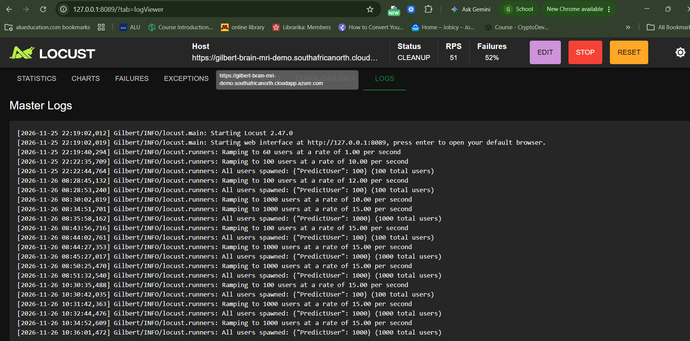

# Final Azure load-test evidence

One Azure stress-test report, its supporting Locust screenshot and owner-provided
routing checks for 1, 2 and 3 API replicas are recorded here.
The API replica count was confirmed by the project owner; it is not recorded in
the HTML export. The project author confirms that the
[video demonstration](https://youtu.be/7QIUv2JxGkg) includes the Azure performance
comparison with 1, 2 and 3 replicas and production model evaluation. This folder
contains supplementary evidence; separate HTML/CSV exports for the complete
comparison are not attached. No additional numerical results have been inferred
from the video. The earlier local measurements remain in the sibling `1_replicas/`,
`2_replicas/` and `3_replicas/` folders outside this directory.

## Attached run: 1 API replica, 1,000 users

- [Original Locust HTML report](1_replicas/20261126_083858_1000users/report.html)
  (download and open in a browser to view the interactive report).
- [Locust logs screenshot](1_replicas/20261126_083858_1000users/locust-logs.png).
- Target: `POST /api/predict` at
  `https://gilbert-brain-mri-demo.southafricanorth.cloudapp.azure.com`.
- Exported reporting window: **26 November 2026, 08:38:58–08:39:16 UTC**
  (**10:38:58–10:39:16 Kigali time**); the report labels this as **18 seconds**.
- **1 API replica**, confirmed by the project owner; **1,000 simulated users**
  in the report's history before its final stop snapshot.
- The screenshot shows Locust **2.47.0**, a ramp to 1,000 users at **15 users/s**
  at 10:34:52, and all 1,000 spawned by 10:36:01. It contains several runs and
  changes in user counts, so it does not establish a fixed configuration for
  the entire session. Its timestamps do not display a timezone.

Measured results from the report's aggregate statistics:

- **902 requests: 431 successful, 471 failed (52.22%).**
- **49.22 total requests/s**, including failures; **23.52 successful requests/s**
  derived by subtracting the reported failure rate of 25.70 failures/s.
- Average response time: **20.163 s**; median: **16 s**; **p95: 48 s**;
  **p99: 69 s**. These aggregate timings include failed requests.
- Failures: **154 HTTP 500**, **310 HTTP 502**, **5 HTTP 504**, and **2 client
  failures recorded as `HTTP 0`** (0 is not an HTTP response status).

The deployment did not serve this recorded load reliably: over half of requests
failed, and latency was high. The evidence is consistent with overload, but the
precise cause requires server logs and resource measurements from the same run.
The screenshot's **51 RPS** is a live reading; the exported aggregate is **49.22
RPS**, so it should not be reported as 51 successful predictions per second.

The maximum recorded response time is **156.033 s**, longer than the reported
18-second window. The export does not explain reset or in-flight request timing;
do not treat the window as the complete run duration or a steady-state benchmark.
VM limits, image selection, warm-up/reset policy and model version were not
captured with this report. This run predates the HDF5 deployment at 13:39 UTC on
the same day, so it does not verify performance after that update.



The HTML was copied byte-for-byte from
`Locust_2026-11-26-10h38_locustfile.py_https___gilbert-brain-mri-demo.southafricanorth.cloudapp.azure.com.html`.
Its SHA-256 is
`92576bc5b2cc4d8c73111a4583c273780d54e2cf0494d1610e58b350a55b7d9d`.
No missing CSVs or measurements were generated.

## Routing checks across 1, 2 and 3 API replicas

Source: terminal output supplied by the project owner on **26 November 2026**.
These are historical observations, not checks rerun while documenting them.
Each invocation made **20 sequential GET requests** to the public `/api/health`
endpoint and grouped the returned `served_by` container identifiers:

```powershell
1..20 | ForEach-Object {
    (Invoke-RestMethod -Uri "https://gilbert-brain-mri-demo.southafricanorth.cloudapp.azure.com/api/health" -TimeoutSec 10).served_by
} | Group-Object | Select-Object Count, Name
```

Observed distributions under the reported replica configurations:

- **1 replica:** `a91f9d6c0cb8` served **20/20** requests (100%).
- **2 replicas:** `a91f9d6c0cb8` served **10/20** and `4c0a822a8231` served
  **10/20** (50% each).
- **3 replicas, first check:** `f8cdef92a060` served **7/20**,
  `460872a16025` served **7/20**, and `a91f9d6c0cb8` served **6/20**
  (35%, 35%, 30%).
- **3 replicas, repeated check:** `a91f9d6c0cb8` served **7/20**,
  `460872a16025` served **7/20**, and `f8cdef92a060` served **6/20**
  (35%, 35%, 30%).

These observations show that the public route reached different API containers
and distributed these small health-check samples evenly. The one-container
sample shows one responding container; it cannot establish by itself that no
other container was running.

The command does **not** submit an MRI for inference, generate concurrent load,
or record response timings. It supports the load-balancing demonstration but
does not measure prediction latency, throughput or failure rate under load.
The pasted output has no timestamps or associated Locust run identifiers, so
these checks cannot be matched to the attached 1,000-user report. The project
author identifies the linked video as the evidence for the prediction performance
comparison across replica counts.

## Adding further report exports

The comparison is demonstrated in the video. To supplement it with downloadable
reports, use these locations:

```text
loadtest/results/azure_final/
  1_replicas/
  2_replicas/
  3_replicas/
```

For each run, save the Locust HTML report and downloaded statistics/history/failure
CSVs when available, plus the resource-usage recording and evidence of which API
containers served requests. Preserve the actual measurements and label warm-up
output separately.

Record the date, VM size, API replica count, users, spawn rate, duration, endpoint,
image set, model version and load-generator location. Compare throughput, failure
rate, median response time, p95 and p99 under the same workload. If a run used
different conditions, state that rather than claiming a controlled comparison.

The attached 1,000-user stress test cannot be compared directly with the earlier
60-user local runs. Any additional exported results should identify their actual
conditions and be linked from the main README. Public hostnames and container
identifiers are useful context; admin keys,
private keys, tokens and full private configuration dumps must not appear in reports.
